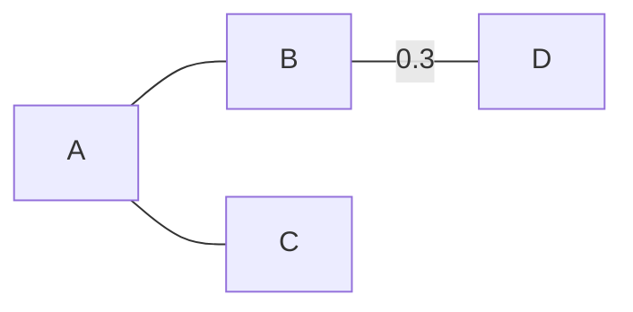

# ТЗ: «Живой учебник» — просмотрщик и редактор Markdown для уроков математики и информатики

*Версия 5 от 13.11.2026 — по решениям брифинга 13.11 (журнал — `docs/komanda/BRIFING.md`). Версия 4 — 28.10.2026.*

Рабочее имя редактора в проекте — «Живой конспект».

## 1. Назначение

«Живой учебник» — бесплатный просмотрщик и редактор Markdown-документов для уроков математики (5–11 класс) и информатики (7–11 класс). В первую очередь это просмотрщик, во вторую — редактор.

**Две версии (решение 13.11):**
- **онлайн-приложение** (открывается в браузере, в том числе на школьных ноутбуках) — **основа**, делается первым;
- **офлайн-приложение** для Windows, macOS и Linux — собирается из онлайн-версии, работает без интернета.

| Кто | Что делает | Режим |
| --- | --- | --- |
| Учитель | пишет конспекты, решения задач, алгоритмы; печатает и раздаёт | редактор + просмотр |
| Ученик | читает, запускает и меняет примеры, повторяет решения в своих документах | просмотр, по желанию редактор |

**Главные принципы**

1. Документ — обычный `.md`-файл. Он читается на GitHub и в любом редакторе, а наши расширения видны там как аккуратные блоки кода.
2. Всё нарисованное описано текстом внутри документа: графики, чертежи, схемы, поля исполнителей. Отдельных картинок, которые теряются, нет.
3. Для школьных задач — простой русский синтаксис с общими правилами для всех блоков (раздел 10). Для сложных случаев — «сырой» режим библиотеки.
4. Просмотр работает всегда. Python запускается, только если интерпретатор указан в настройках и проверен.
5. Библиотеки лежат внутри программы: офлайн-версия работает без сети, онлайн-версия не зависит от чужих серверов (кроме перехода на qumir.dev, раздел 5).
6. Экзаменационные среды (IDLE, Python, `turtle`, КуМир) не подменяются: программа повторяет их поведение и служит мостиком к ним.

### 1.1. Ветки проекта и состояние (сверка 13.11)

| Ветка | Раздел | Состояние | Что нужно, чтобы закрыть |
|---|---|---|---|
| Базовый Markdown | 2 | не начато | каркас онлайн-версии (этап 1) |
| ГРАФ — отдельный мини-проект | 3 | язык v8, генератор опубликован | библиотека, сайт, учебник, навык ИИ, база примеров |
| ДРАКОН | 4 | обёртка `drakon-shema` 1.4, текстовая запись утверждена | разборщик текста, экспорт `.drakon`, подветка Python ↔ ДРАКОН |
| Исполнители | 5 | на qumir.dev, свои не делаем | импорт обстановок `.fil` |
| Математика, Python, экспорт | 6–8 | не начато | тестовый набор формул (задание 002) |
| Архитектура | 9 | решено: онлайн → офлайн | сборка офлайн-версии — когда будет онлайн |

**Сверх ТЗ v4** (появилось к 13.11): онлайн-версия редактора; связь с qumir.dev; команда помощников ИИ (`ii-komanda`); мини-учебники на ДРАКОН-ГРАФе; генерация схем нейросетью (ИИ-формат DrakonHub).

## 2. Базовый Markdown

*Состояние на 13.11: не начато, принято к сведению.*


| Возможность | Чем реализуется | Лицензия |
| --- | --- | --- |
| CommonMark + GitHub (таблицы, чек-листы, сноски, зачёркивание, `> [!NOTE]`) | markdown-it + плагины | MIT |
| Формулы `$…$`, `$$…$$` | KaTeX | MIT |
| Схемы mermaid, включая `xychart` | mermaid | MIT |
| Встроенный и подключаемый SVG | санитайзер DOMPurify | Apache-2.0 / MPL |
| Подсветка в просмотре | highlight.js | BSD-3 |
| Редактор с подсветкой Markdown и Python | CodeMirror 6 | MIT |

**Редактор:**
- две панели (текст и живой просмотр) с синхронной прокруткой;
- автообновление при сохранении файла в другом редакторе;
- вставка шаблонов блоков из меню;
- картинки и данные подключаются относительными путями из папки документа.

## 3. Конспекты: расширенная версия языка ГРАФ

**Создатель оригинального языка ГРАФ — В. Д. Паронджанов** (при участии Г. А. Гуленкова). Автор расширенной версии — С. Н. Веснин.

**Действующее описание — [формальное описание](../graf/формальное_описание.md)** (эталон зафиксирован 30.10.2026). Оно заменяет прежний текст этого раздела и описание блока `конспект` в разделе 10. Если ТЗ и формальное описание расходятся, верно формальное описание.

**Коротко:**
- ГРАФ — единый язык конспектов по Паронджанову: ГНОМ вошёл в него как запоминатели (`вопрос -> ответ`), МОЛНИЯ — как разбор `[часть]{подпись}`. Отдельных профилей нет.
- 17 схем: 14 по Паронджанову и 3 новые (Дерево, Сцена, Шеренга). Схема выбирается сама по форме текста или задаётся строкой `схема:`.
- Пара языков: ГРАФ — *что знать* (декларативное знание), ДРАКОН — *как действовать* (раздел 4).
- Подсказки вместо ошибок: любой текст рисуется, неудачные места отмечаются советом.

**ГРАФ — отдельный мини-проект (решение 13.11).** Довести до законченного вида:
- библиотека для встраивания (в «Живой конспект», сайт уроков, генератор);
- сайт ДРАКОН-ГРАФ — законченный и регулярно обновляемый;
- онлайн-генератор с печатью и импортом — опубликован: https://scatik146.github.io/drakon-graf/generator/ (встроить в редактор);
- учебник на Markdown и ДРАКОН-ГРАФе;
- навык для ИИ (`graficheskij-konspekt`), регулярно улучшается;
- пополняемая база примеров по темам с онлайн-просмотром;
- небольшая реклама в сети.

**Документы версии 8:**

| Документ | Для кого |
|---|---|
| [формальное описание](../graf/формальное_описание.md) — лексика, грамматика EBNF, фигуры, схемы, правила раскладки, подсказки | разработчик, дизайнер |
| [справочник учителя](../graf/справочник_учителя.md) — от задачи к конспекту | учитель |
| [шпаргалка ученика](../graf/шпаргалка_ученика.md) — по ступеням 5–6, 7–9, 10–11 | ученик |
| папка [`graf/`](../../graf) — прототип движка, 249 эталонных примеров, автотесты (`node tests/run.js`) | разработчик |

**Приёмка.** Реализация ГРАФа в программе принимается, если все 249 эталонных примеров дают те же рисунки и подсказки, что эталон, а геометрическая и типографская проверки не находят замечаний. Требования к набору формул, кеглю и печати — раздел 8.1.

**Вне версии 8:** визуальный редактор ГРАФ (правка схемы мышью). В программе конспект правится как текст; виджет показывает схему, поддерживает самопроверку, слепыш, ч/б и экспорт.

## 4. ДРАКОН

**Язык ДРАКОН не меняется.** На схеме остаются канонические иконы и графические правила Паронджанова: шампур, «чем правее, тем хуже», отсутствие пересечений, примитив и силуэт. Сохраняется совместимость с `.drakon`, DrakonHub и DrakonTech.

**Ввод — текстовая запись.** Схема описывается блоком `дракон` (`drakon`): одна строка — одна икона, вложение — сдвигом на 2 пробела, ключевое слово с двоеточием в начале строки. Действующее описание — [текстовая запись дракон-схем](../drakon/текстовая_запись.md) (утверждена 13.11.2026): словарь, примеры, ступени 5–6, 7–9 и старших классов, что не поддерживаем. Если ТЗ и описание расходятся, верно описание.

**Своего генератора нет (решение 13.11).** Рисует общая библиотека — обёртка `drakon-shema` (teacher-workpad) над DrakonWidget С. Митькина:
- текст → короткий формат обёртки → схема (разборщик — задание teacher-workpad `zadaniya/004`, проверка `tools/drakon-shema.mjs`);
- схема → текст — по образцу `drakongen.js` Митькина;
- экспорт `.drakon` и выгрузка — в той же библиотеке, ей пользуются и сайт уроков, и редактор.

**Гибридный язык.** Внутри икон допускаются обычные русские слова, выражения в стиле Python и команды исполнителей КуМира (раздел 5).

**Возможности блока `дракон`:**
- **просмотр:** схема, масштаб, псевдокод и маршруты (уже есть в обёртке);
- **выгрузка и печать** — обязательно: SVG/PNG, лист для печати;
- **обмен с проектами Митькина** — обязательно: экспорт и импорт `.drakon`, формат DrakonHub;
- **код по схеме:** Python, КуМир в стиле ОГЭ, C, 1С (уже есть в обёртке);
- **запуск:** перевод в Python и выполнение в консоли (раздел 7), подсветка текущей иконы при пошаговом выполнении;
- **визуальная правка** для учителя «по намерению» с автораскладкой. Источник истины — текст: правка схемы записывается обратно в блок.

### 4.1. Python ↔ ДРАКОН — главная подветка

- **Python → ДРАКОН:** для подмножества Python (без функций и классов) схема строится прямо из кода ученика — он пишет программу и видит её «чертёж».
- **ДРАКОН → Python:** схема с выражениями в иконах переводится в программу; схема и код сравниваются построчно.
- **Запись согласована с Python:** выражения как в Python; `выход из цикла` = `break`, `к следующему шагу` = `continue`; «?» в конце условия программа дописывает сама, поэтому условие переносится из кода без правки; `return` не поддерживаем (описание, § 5).
- **Проверка:** набор пар «код ↔ схема» в автотестах.

**Порядок освоения:** сначала примитив (действия, развилки, циклы, ввод и вывод), затем силуэт с ветками — по ступеням описания (§ 4).

## 5. Исполнители и КуМир

**Исполнители — на qumir.dev (решение 13.11).** Робот, Черепаха, Чертёжник и редактор обстановок уже есть на qumir.dev — своих не делаем. Синтаксис ДРАКОНа к КуМиру не привязывается; привязываются команды: в иконах и в блоке `кумир` они пишутся как в КуМире, поэтому задачу из ОГЭ или ЕГЭ можно переносить без переделки.

**Импорт обстановок стандартного вида (`.fil`).** Файл обстановки лежит рядом с `.md`; программа поднимает обстановку и показывает поле в документе — так же, как текстовые файлы с данными для Python. Поле печатается и попадает в HTML-экспорт.

**Ссылки на файлы — служебными комментариями (решение 13.11).** Язык расширяется только комментарием с чётким синтаксисом «ключевое слово с двоеточием», поэтому программа без изменений работает в настоящем КуМире, на qumir.dev и в IDLE:
- в КуМире: `| обстановка: до-стены.fil`;
- в Python: `# данные: числа.txt`.

**Выполнение блока `кумир` (предложение 13.11, ждёт решения).** Блок `кумир` остаётся. По кнопке «Выполнить» программа переводится в WebAssembly на qumir.dev, а исполняется у нас средой выполнения Qumir (BSD-2: Робот, Черепаха, Чертёжник, Рисователь, ввод) — поле и анимация в документе. Офлайн — с компилятором `qumirc` внутри программы. Кнопка «Открыть в КуМире онлайн» остаётся. Разбор — `docs/research/10`, § 5.

**Команды исполнителей** (справочно — для икон ДРАКОНа и блока `кумир`):

| Исполнитель | Команды (запись КуМира) | Где нужен |
| --- | --- | --- |
| Робот | `вверх`, `вниз`, `влево`, `вправо`, `закрасить`; условия `сверху свободно`, `снизу стена`, `слева свободно`, `справа стена` и т. д., `клетка закрашена`, `клетка чистая` | ОГЭ 15, 7–9 класс |
| Черепаха | `вперед(n)`, `назад(n)`, `вправо(угол)`, `влево(угол)`, `поднять хвост`, `опустить хвост` | ЕГЭ 6, 7–9 класс |
| Чертёжник | `сместиться в точку(x, y)`, `сместиться на вектор(dx, dy)`, `поднять перо`, `опустить перо` | 7–9 класс, координаты |

Буква «ё» в командах допускается наравне с «е» (`вперёд` = `вперед`).

**Подмножество КуМира (блок `кумир`)** — только то, что нужно для задач исполнителей:

| Конструкция | Запись |
| --- | --- |
| Программа | `использовать Робот`, `алг`, `нач`, `кон` |
| Развилка | `если … то … иначе … все` |
| Цикл с условием | `нц пока … кц` |
| Цикл N раз | `нц N раз … кц` |
| Цикл со счётчиком | `нц для i от 1 до N … кц` |
| Счётчик | `цел n`, `n := 0`, `n := n + 1`, вывод `вывод n` |
| Условия | сравнения `= <> < > <= >=`, связки `и`, `или`, `не` |

Не поддерживаются: вспомогательные алгоритмы с параметрами, таблицы, строки, вещественные числа, файлы. Если ученик напишет такую конструкцию, программа честно сообщит «не поддерживается в учебном КуМире».

**Общее ядро.** Программа на КуМире и текстовый ДРАКОН переводятся в одно представление алгоритма (короткий формат обёртки `drakon-shema`). Поэтому программа на КуМире показывается ДРАКОН-схемой, а по схеме строится код на КуМире.

**Черепаха и Python.** Для ЕГЭ 6 ученик пишет на Python с настоящим `turtle`, который открывается в своём окне, как в IDLE (раздел 7). Черепаха КуМира — на qumir.dev.

## 6. Математика 5–11 класс

*Состояние на 13.11 (§ 6–8): не начато. Сначала — тестовый набор формул для проверки (задание помощнику 002; образец — из физики).*

**Правило распределения:** что mermaid умеет хорошо, остаётся mermaid (так документ лучше читается на GitHub). Всё, что требует координат, формул или геометрических построений, — один собственный язык `мат`. Статистические данные — маленький язык `диаграмма`.

| Тема | Что рисуем | Чем |
| --- | --- | --- |
| 5–6: числа, дроби | числовая прямая, координатный луч, доли | `мат` (режим прямой) |
| 6–11: функции | все элементарные функции, преобразования графиков | `мат` → JSXGraph |
| Тригонометрия | единичная окружность, линии синуса, косинуса, тангенса | `мат` |
| Анализ | касательная, экстремумы, площади под графиками | `мат` |
| Параметры | семейство графиков с ползунком | `мат` |
| Неравенства | метод интервалов, области на плоскости | `мат` |
| Комплексные числа | точки и векторы на плоскости | `мат` |
| Множества | круги Эйлера | `мат` (команда `эйлер`) |
| Планиметрия 7–11 | треугольники, окружности, построения, векторы | `мат` (без осей) |
| ВиС: графы, деревья вероятностей | вершины, рёбра, веса | mermaid (свой язык не нужен) |
| ВиС: статистика | гистограммы, рассеивание, полигон частот | `диаграмма` → Chart.js |
| Простые круговые и столбчатые | доли, сравнения | mermaid `pie`, `xychart` |
| Блок-схемы, автоматы, mind-map | | mermaid |

**Почему `мат` — один язык:** в школьных задачах геометрия и функции постоянно встречаются вместе (касательная к окружности, задача с параметром, решаемая графически, площадь между кривыми). Слова `график`, `чертёж`, `прямая`, `эйлер` в заголовке блока — синонимы `мат`, задающие настройки по умолчанию: оси, сетка, масштаб.

Стереометрия в первую версию не входит.

## 7. Python

**Настройки:**
- путь к интерпретатору и кнопка «Найти автоматически»: `py`, `python` в PATH, `%LOCALAPPDATA%\Programs\Python`;
- проверка запуском `python -c "import sys; print(sys.version)"` с показом версии;
- если путь не задан или неверен, кнопки серые с подсказкой «Python не настроен».

**Настоящая консоль.** Python запускается в настоящем терминале Windows (ConPTY), в окне терминал рисует xterm.js. Поэтому `input()` ведёт себя честно, работают история команд стрелками, Ctrl+C и цвета, а `turtle` и `tkinter` открываются в своих окнах.

**Модель IDLE**

| Действие | Что происходит |
| --- | --- |
| ▶ в блоке | программа выполняется в чистом процессе, ввод и вывод — под блоком. Результат можно напечатать |
| ▶▶ «В консоль» (как F5 в IDLE) | консоль перезапускается, блок выполняется в ней, затем консоль остаётся открытой: можно проверить `>>> a[3]` |
| Панель «Консоль» внизу | свободные эксперименты, как IDLE Shell |
| «Открыть в IDLE» | копия блока открывается в самом IDLE (`python -m idlelib`) |

Перезапуск перед каждым «В консоль» исключает «скрытое состояние», когда переменные остаются от прошлых запусков.

**Прочее:**
- рабочая папка — папка документа, поэтому `open("data.txt")` работает;
- `PYTHONIOENCODING=utf-8`, чтобы не было проблем с кириллицей;
- ошибки выделены красным, номера строк соответствуют строкам блока;
- атрибут `{ввод="5\n3"}` для заранее заданного ввода в демонстрациях и при печати;
- кнопки «Стоп» и «Вернуть код»;
- чужой документ ничего не запускает сам, только по нажатию кнопки.

## 8. Экспорт и печать

- **Экспорт в один самодостаточный HTML-файл:** стили, шрифты и рисунки встроены, открывается в любом браузере без программы.
- **Стили печати:** формат A4, рисунки и код не разрываются между страницами, принудительный разрыв задаётся вручную.
- **Настройки экспорта:** показывать или скрывать код и вывод программ.
- **Печать и PDF** прямо из программы через системный диалог.
- **«Запекание» в SVG:** рисунки наших блоков можно сохранить картинками, чтобы они были видны на GitHub.

### 8.1. Набор формул, кегль и печать (по проверке дизайнера учебных изданий, 30.10.2026)

**Формулы — только KaTeX, везде.** Всё математическое набирается через KaTeX: формулы в тексте, в выкладке, в подписях разбора `[…]{…}`, в ячейках Шеренги, в указателях, на рисунках схем. Самодельная замена (Unicode-индексы, «/» вместо дроби) не допускается: прототип её использует только для черновой проверки раскладки. Требования (ГОСТ 8.417-2002, ISO 80000-2):
- буквенные обозначения величин — курсивом; числа, обозначения единиц, функции (sin, log, lim) — прямым шрифтом;
- векторы — со стрелкой над буквой (`\vec F`), смысл не теряется;
- индексы — настоящие нижние и верхние, в том числе кириллические (`Q_{\text{отд}}`);
- в выключных формулах `$$…$$` дробь двухэтажная (`\frac`), в строчных допускается косая черта;
- единицы — через пробел от числа (неразрывный), кроме °, ′, ″; «°C» — с пробелом; точка умножения в обозначении единицы без пробелов: «Дж/(кг·°C)».

**Кегль задаётся в пунктах для печати, а не в пикселях.** Схема печатается на ширину полосы; программа пересчитывает размеры так, чтобы кегль на бумаге соответствовал гигиеническим нормативам к учебным изданиям (СанПиН 1.2.3685-21) по классу и виду текста: основной текст блоков, дополнительный (выноски, обоснования выкладки), подписи разбора. Перед реализацией значения сверяются с официальной таблицей СанПиН и заносятся в таблицу настроек `класс:` → кегль. Если схема при печати не помещается без уменьшения ниже нормы, она переносится на отдельную полосу или разбивается по зонам, а не ужимается.

**Заглушка рисунка не печатается.** Строка `рисунок: описание` в редакторе показывается пунктирной рамкой с текстом. В просмотре, экспорте и печати на её месте — подключённый рисунок; если рисунка нет, рамка не выводится, а в списке замечаний документа появляется «рисунок не подключён». Подпись рисунка — по образцу «Рис. 3.», если в документе включена нумерация рисунков.

**Типографика в движке схем** (уже в прототипе, справочник Мильчина и Чельцовой):
- неразрывный пробел после коротких предлогов, союзов и «не», перед тире, между числом и единицей, между группами разрядов, после № и §;
- короткая концевая строка выравнивается подбором ширины без новых переносов;
- переносы по слогам — только в тексте блоков и листьях Дерева; в заголовках, указателях и шапках слова не переносятся (ширина колонки по самому длинному слову, при нехватке — кегль меньше на 1 px);
- в колонке сцены однострочные блоки по центру, многострочные — влево;
- номер в ГНОМе — вплотную к блоку, номера образуют столбец (как рис. 30 Паронджанова); выноска пронумерованного блока — под блоком;
- подсказки о точке: блок-предложение заканчивается точкой; в заголовках, ячейках и подписях точку не ставят.

## 9. Архитектура

**Решение 13.11: сначала онлайн-версия, потом офлайн.** Онлайн-приложение — статический сайт (GitHub Pages) на тех же библиотеках, что и сайт уроков; данные документа хранятся у пользователя (файлы, браузер). Офлайн-версия для Windows, macOS и Linux собирается из онлайн-кода; способ сборки выбираем, когда будет онлайн-версия.

Кандидаты офлайн-сборки (из ТЗ v4):

| | Tauri 2 | Electron |
| --- | --- | --- |
| Размер | ~15–25 МБ | ~150 МБ |
| Движок | WebView2 / WebKit | Chromium |
| Консоль Python | Rust + portable-pty | Node.js + node-pty |

**Состав интерфейса:** CodeMirror 6, markdown-it, KaTeX, mermaid, JSXGraph, Chart.js, xterm.js; общие библиотеки проекта — ГРАФ (раздел 3) и `drakon-shema` с DrakonWidget (раздел 4); язык `мат`.

**Python в онлайн-версии — Skulpt (решение 13.11).** Берём форк StepInDev (`step-in-dev/skulpt`, MIT) и ведём свой: `input()` и `print` в панели под редактором, Черепаха, пошаговое выполнение. Онлайн — простые задачи; файлы большого объёма и вся стандартная библиотека — в офлайн-версии (настоящий Python). Разбор — `docs/research/11`.

Библиотеки ЕГЭ в своём форке:

| Модуль | Что нужно | В форке |
|---|---|---|
| `turtle` | ЕГЭ 6 | есть |
| `math` | везде | есть |
| `itertools` | `permutations`, `product` (ЕГЭ 8) | есть |
| `functools` | `lru_cache`, `cache` (рекурсия, ЕГЭ 16, 23) | есть |
| `fnmatch` | маски (ЕГЭ 25) | есть |
| `ipaddress` | сети (ЕГЭ 13; в проекте демоверсии 2027 числился № 10, в итоговой — снова 13) | **нет** — собрать из CPython `ipaddress.py` и подключить |

**Файлы.** Skulpt в браузере открывает файл через элемент страницы с `id`, равным имени файла. Редактор читает файл, указанный служебным комментарием `# данные: 17.txt`, из папки документа и подкладывает его — `open("17.txt")` работает как обычно; запись (`"w"`, `"a"`) идёт в память через `Sk.filewrite` и может быть сохранена рядом с `.md`. Ограничение — скорость: Skulpt в десятки раз медленнее CPython, поэтому задачи на большие файлы (ЕГЭ 17, 24, 26, 27) — офлайн.

**Сборки офлайн-версии:** установщик и портативная версия (папка без установки — для школьных компьютеров с ограниченными правами), бесплатно через GitHub Actions.

## 10. Синтаксис блоков

**Общие правила для наших блоков `мат`, `диаграмма`, `дракон`, `конспект`**, чтобы детям не учить несколько синтаксисов:
- выражения пишутся как в Python: `x**2`, `n // 10`, `a % 2 == 0`;
- комментарии через `#`;
- ключевое слово — в начале строки, строчными буквами, с двоеточием: `вопрос:`, `пока:`, `для:`, `выбор:`, `ввод:`, `вывод:`; «ё» = «е»; `\` в начале строки отменяет ключевое слово;
- вложенность — сдвигом на 2 пробела (Tab = 2 пробела);
- у каждого блока и каждого ключевого слова есть английский синоним (`math`, `chart`, `drakon`; `if:`, `while:`, `for:`).

Полные описания: `конспект` — [формальное описание ГРАФа](../graf/формальное_описание.md); `дракон` — [текстовая запись дракон-схем](../drakon/текстовая_запись.md). Блок `робот` из ТЗ v4 заменён импортом обстановок `.fil` (раздел 5).

Блок `кумир` — исключение: в нём пишут настоящим КуМиром (раздел 5), чтобы тексты из КИМ переносились без правок.

**Примеры (черновик)**

````
```python {ввод="5"}
n = int(input("n = "))
print(n * n)
```

```мат
f(x) = x**2 - 4*x + 3
касательная к f в x=2
площадь под f от 1 до 3
окно: x -1..5, y -2..6
```

```мат чертёж
A = (0,0); B = (6,0); C = (2,4)
треугольник ABC
описанная окружность ABC
высота из C
```

```мат
# функции и геометрия вместе
окружность O(0,0) радиус 2
f(x) = a*x + 2
ползунок a от -3 до 3
```

```мат прямая
корни: -2, 1(выколотая), 3
знаки: + - + -
```

```мат эйлер
A: 1 2 3 4
B: 3 4 5
```

```диаграмма
тип: гистограмма
данные: рост.txt
```



```дракон
название: Сумма цифр
ввод: n
s = 0
пока: n > 0
  s = s + n % 10
  n = n // 10
вывод: s
```

```дракон
название: До стены
пока: справа свободно
  вправо
  вопрос: снизу стена
    да: закрасить
    нет:
```

Обстановка Робота — файл `до-стены.fil` рядом с документом; ссылка на него — служебным комментарием в программе (раздел 5).

```кумир
| обстановка: до-стены.fil
использовать Робот
алг
нач
  цел n
  n := 0
  нц пока справа свободно
    вправо
    если снизу стена то
      закрасить
      n := n + 1
    все
  кц
  вывод n
кон
```

```кумир
использовать Черепаха
алг
нач
  опустить хвост
  нц 4 раз
    вперед(10)
    вправо(90)
  кц
кон
```

```конспект
тема: Деление с остатком
правило → остаток: Остаток всегда меньше делителя.
пример: [17]{делимое} = [5]{делитель} · [3]{неполное частное} + [2]{остаток}
```
````

На GitHub наши блоки показываются как код; при экспорте их можно «запечь» в SVG.

## 11. Этапы

1. **Каркас онлайн-версии:** открытие `.md`, просмотр (GFM, KaTeX, mermaid, SVG, подсветка), публикация на GitHub Pages.
2. **Редактор:** CodeMirror, две панели, шаблоны блоков.
3. **ГРАФ и ДРАКОН в редакторе:** общие библиотеки (разделы 3, 4); разборщик текстовой записи; выгрузка, печать, `.drakon`.
4. **Python ↔ ДРАКОН** (раздел 4.1).
5. **Импорт обстановок `.fil`** и ссылки на qumir.dev (раздел 5).
6. **Экспорт HTML и печать.**
7. **Математика I и II:** язык `мат`, `диаграмма`, геометрия — после тестового набора формул.
8. **Python:** запуск блоков (онлайн — по решению раздела 12; офлайн — настоящая консоль, IDLE, `turtle`).
9. **Офлайн-версия:** выбор сборки, установщик и портативная версия для Windows, затем macOS и Linux.

Рабочий минимум — этапы 1, 2, 3 и 6.

## 12. Риски и открытые вопросы

- **Школьные компьютеры с ограниченными правами:** снимается онлайн-версией; для офлайн — портативная сборка.
- **DrakonWidget:** схема уже строится программно (обёртка `drakon-shema`); перед выпуском редактора — сверить лицензию и формат `.drakon`.
- **qumir.dev:** перевод программ идёт через их сервер — написать авторам до выпуска; запасной путь — своя копия `qumir-service` (BSD-2).
- **Python в онлайн-версии (Skulpt):** собрать `ipaddress`; исправить чтение последней строки файла без `\n` (сейчас она теряется); замерить скорость на файлах ЕГЭ и указать порог «дальше — офлайн».
- **КуМир:** учебное подмножество (раздел 5); написания команд сверяются с актуальными КИМ ОГЭ и ЕГЭ.
- **ГРАФ:** язык зафиксирован (v8). Для визуального редактора ГРАФ не хватает описания: связи фигур с текстом, полного набора операций правки и их действия на текст, канонической записи текста, интерфейса и API виджета.
- **Вопрос:** окончательное название программы.
