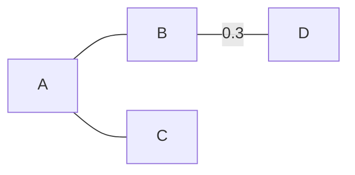

# ТЗ: «Живой учебник» — просмотрщик и редактор Markdown для уроков математики и информатики

*Версия 4 от 28.10.2026*

## 1. Назначение

«Живой учебник» — бесплатная автономная программа для Windows 10/11 (macOS — позже). В первую очередь это просмотрщик, во вторую — редактор Markdown-документов для уроков математики (5–11 класс) и информатики (7–11 класс). Распространяется свободно, работает без интернета.

| Кто | Что делает | Режим |
| --- | --- | --- |
| Учитель | пишет конспекты, решения задач, алгоритмы; печатает и раздаёт | редактор + просмотр |
| Ученик | читает, запускает и меняет примеры, повторяет решения в своих документах | просмотр, по желанию редактор |

**Главные принципы**

1. Документ — обычный `.md`-файл. Он читается на GitHub и в любом редакторе, а наши расширения видны там как аккуратные блоки кода.
2. Всё нарисованное описано текстом внутри документа: графики, чертежи, схемы, поля исполнителей. Отдельных картинок, которые теряются, нет.
3. Для школьных задач — простой русский синтаксис с общими правилами для всех блоков (раздел 10). Для сложных случаев — «сырой» режим библиотеки.
4. Просмотр работает всегда. Python запускается, только если интерпретатор указан в настройках и проверен.
5. Никакой сети: все библиотеки лежат внутри программы.
6. Экзаменационные среды (IDLE, Python, `turtle`, КуМир) не подменяются: программа повторяет их поведение и служит мостиком к ним.

## 2. Базовый Markdown

| Возможность | Чем реализуется | Лицензия |
| --- | --- | --- |
| CommonMark + GitHub (таблицы, чек-листы, сноски, зачёркивание, `> [!NOTE]`) | markdown-it + плагины | MIT |
| Формулы `$…$`, `$$…$$` | KaTeX | MIT |
| Схемы mermaid, включая `xychart` | mermaid | MIT |
| Встроенный и подключаемый SVG | санитайзер DOMPurify | Apache-2.0 / MPL |
| Подсветка в просмотре | highlight.js | BSD-3 |
| Редактор с подсветкой Markdown и Python | CodeMirror 6 | MIT |

**Редактор:**
- две панели (текст и живой просмотр) с синхронной прокруткой;
- автообновление при сохранении файла в другом редакторе;
- вставка шаблонов блоков из меню;
- картинки и данные подключаются относительными путями из папки документа.

## 3. Конспекты: расширенная версия языка ГРАФ

**Создатель оригинального языка ГРАФ — В. Д. Паронджанов** (при участии Г. А. Гуленкова). Автор расширенной версии — С. Н. Веснин.

**Действующее описание — [формальное описание](../graf/формальное_описание.md)** (эталон зафиксирован 30.10.2026). Оно заменяет прежний текст этого раздела и описание блока `конспект` в разделе 10. Если ТЗ и формальное описание расходятся, верно формальное описание.

**Коротко:**
- ГРАФ — единый язык конспектов по Паронджанову: ГНОМ вошёл в него как запоминатели (`вопрос -> ответ`), МОЛНИЯ — как разбор `[часть]{подпись}`. Отдельных профилей нет.
- 17 схем: 14 по Паронджанову и 3 новые (Дерево, Сцена, Шеренга). Схема выбирается сама по форме текста или задаётся строкой `схема:`.
- Пара языков: ГРАФ — *что знать* (декларативное знание), ДРАКОН — *как действовать* (раздел 4).
- Подсказки вместо ошибок: любой текст рисуется, неудачные места отмечаются советом.

**Документы версии 8:**

| Документ | Для кого |
|---|---|
| [формальное описание](../graf/формальное_описание.md) — лексика, грамматика EBNF, фигуры, схемы, правила раскладки, подсказки | разработчик, дизайнер |
| [справочник учителя](../graf/справочник_учителя.md) — от задачи к конспекту | учитель |
| [шпаргалка ученика](../graf/шпаргалка_ученика.md) — по ступеням 5–6, 7–9, 10–11 | ученик |
| папка [`graf/`](../../graf) — прототип движка, 249 эталонных примеров, автотесты (`node tests/run.js`) | разработчик |

**Приёмка.** Реализация ГРАФа в программе принимается, если все 249 эталонных примеров дают те же рисунки и подсказки, что эталон, а геометрическая и типографская проверки не находят замечаний. Требования к набору формул, кеглю и печати — раздел 8.1.

**Вне версии 8:** визуальный редактор ГРАФ (правка схемы мышью). В программе конспект правится как текст; виджет показывает схему, поддерживает самопроверку, слепыш, ч/б и экспорт.

## 4. ДРАКОН

**Язык ДРАКОН не меняется.** На схеме остаются канонические иконы (заголовок, действие, вопрос, выбор, цикл, ввод, вывод, конец и другие) и графические правила Паронджанова: шампур, «чем правее, тем хуже», отсутствие пересечений, примитив и силуэт. Сохраняется совместимость с `.drakon`, DrakonHub и DrakonTech.

**Упрощается только способ ввода.** Алгоритм описывается несколькими строками текста в блоке `дракон`. Программа строит из него каноническую ДРАКОН-схему и рисует её библиотекой DrakonWidget С. Митькина.

**Гибридный язык.** Внутри икон допускаются обычные русские слова, выражения в стиле Python и команды исполнителей (раздел 5). Если внутри икон стоят выражения или команды исполнителей, схему можно выполнить.

**Возможности блока `дракон`:**
- **просмотр:** схема по правилам ДРАКОНа, масштаб, печать;
- **запуск:** с командами исполнителей — анимация прямо в документе без Python; с выражениями — перевод в Python и выполнение в консоли; подсветка текущей иконы при пошаговом выполнении;
- **визуальная правка** для учителя «по намерению» с автораскладкой. Источник истины — текст: редактор схемы записывает изменения обратно в текст блока;
- **обмен:** импорт и экспорт `.drakon`.

**Python → ДРАКОН.** Для подмножества Python (без функций и классов) схема строится прямо из кода ученика: он пишет программу и видит её «чертёж».

**Порядок освоения:** сначала примитив (действия, развилки, циклы, ввод и вывод), затем силуэт с ветками.

## 5. Исполнители и КуМир

Синтаксис ДРАКОНа к КуМиру не привязывается. Привязываются исполнители: их команды совпадают с командами КуМира, поэтому задачу из варианта ОГЭ или ЕГЭ можно переносить без переделки.

**Исполнители: Робот, Черепаха, Чертёжник.** Все работают прямо в документе, с анимацией, без Python. Рисунок поля печатается и попадает в HTML-экспорт.

| Исполнитель | Команды (запись КуМира) | Где нужен |
| --- | --- | --- |
| Робот | `вверх`, `вниз`, `влево`, `вправо`, `закрасить`; условия `сверху свободно`, `снизу стена`, `слева свободно`, `справа стена` и т. д., `клетка закрашена`, `клетка чистая` | ОГЭ 15, 7–9 класс |
| Черепаха | `вперед(n)`, `назад(n)`, `вправо(угол)`, `влево(угол)`, `поднять хвост`, `опустить хвост` | ЕГЭ 6, 7–9 класс |
| Чертёжник | `сместиться в точку(x, y)`, `сместиться на вектор(dx, dy)`, `поднять перо`, `опустить перо` | 7–9 класс, координаты |

Буква «ё» в командах допускается наравне с «е» (`вперёд` = `вперед`).

**Подмножество КуМира (блок `кумир`)** — только то, что нужно для задач исполнителей:

| Конструкция | Запись |
| --- | --- |
| Программа | `использовать Робот`, `алг`, `нач`, `кон` |
| Развилка | `если … то … иначе … все` |
| Цикл с условием | `нц пока … кц` |
| Цикл N раз | `нц N раз … кц` |
| Цикл со счётчиком | `нц для i от 1 до N … кц` |
| Счётчик | `цел n`, `n := 0`, `n := n + 1`, вывод `вывод n` |
| Условия | сравнения `= <> < > <= >=`, связки `и`, `или`, `не` |

Не поддерживаются: вспомогательные алгоритмы с параметрами, таблицы, строки, вещественные числа, файлы. Если ученик напишет такую конструкцию, программа честно сообщит «не поддерживается в учебном КуМире».

**Общее ядро.** Программа на КуМире и текстовый ДРАКОН превращаются в одно внутреннее представление алгоритма. Поэтому программа на КуМире автоматически показывается ДРАКОН-схемой, а ДРАКОН-схема с командами исполнителей выполняется так же, как КуМир.

**Поле Робота** описывается блоком `робот`: размер, начальная клетка, стены, заранее закрашенные клетки. Учитель может указать ожидаемый результат, и программа проверит решение: подсветит лишние и пропущенные клетки, сообщит, разбился ли Робот о стену.

**Черепаха и Python.** Для ЕГЭ 6 ученик пишет на Python с настоящим `turtle`, который открывается в своём окне, как в IDLE (раздел 7). Черепаха в документе нужна для 7–9 класса и для печатных разборов: она показывает сетку целых точек и масштаб.

## 6. Математика 5–11 класс

**Правило распределения:** что mermaid умеет хорошо, остаётся mermaid (так документ лучше читается на GitHub). Всё, что требует координат, формул или геометрических построений, — один собственный язык `мат`. Статистические данные — маленький язык `диаграмма`.

| Тема | Что рисуем | Чем |
| --- | --- | --- |
| 5–6: числа, дроби | числовая прямая, координатный луч, доли | `мат` (режим прямой) |
| 6–11: функции | все элементарные функции, преобразования графиков | `мат` → JSXGraph |
| Тригонометрия | единичная окружность, линии синуса, косинуса, тангенса | `мат` |
| Анализ | касательная, экстремумы, площади под графиками | `мат` |
| Параметры | семейство графиков с ползунком | `мат` |
| Неравенства | метод интервалов, области на плоскости | `мат` |
| Комплексные числа | точки и векторы на плоскости | `мат` |
| Множества | круги Эйлера | `мат` (команда `эйлер`) |
| Планиметрия 7–11 | треугольники, окружности, построения, векторы | `мат` (без осей) |
| ВиС: графы, деревья вероятностей | вершины, рёбра, веса | mermaid (свой язык не нужен) |
| ВиС: статистика | гистограммы, рассеивание, полигон частот | `диаграмма` → Chart.js |
| Простые круговые и столбчатые | доли, сравнения | mermaid `pie`, `xychart` |
| Блок-схемы, автоматы, mind-map | | mermaid |

**Почему `мат` — один язык:** в школьных задачах геометрия и функции постоянно встречаются вместе (касательная к окружности, задача с параметром, решаемая графически, площадь между кривыми). Слова `график`, `чертёж`, `прямая`, `эйлер` в заголовке блока — синонимы `мат`, задающие настройки по умолчанию: оси, сетка, масштаб.

Стереометрия в первую версию не входит.

## 7. Python

**Настройки:**
- путь к интерпретатору и кнопка «Найти автоматически»: `py`, `python` в PATH, `%LOCALAPPDATA%\Programs\Python`;
- проверка запуском `python -c "import sys; print(sys.version)"` с показом версии;
- если путь не задан или неверен, кнопки серые с подсказкой «Python не настроен».

**Настоящая консоль.** Python запускается в настоящем терминале Windows (ConPTY), в окне терминал рисует xterm.js. Поэтому `input()` ведёт себя честно, работают история команд стрелками, Ctrl+C и цвета, а `turtle` и `tkinter` открываются в своих окнах.

**Модель IDLE**

| Действие | Что происходит |
| --- | --- |
| ▶ в блоке | программа выполняется в чистом процессе, ввод и вывод — под блоком. Результат можно напечатать |
| ▶▶ «В консоль» (как F5 в IDLE) | консоль перезапускается, блок выполняется в ней, затем консоль остаётся открытой: можно проверить `>>> a[3]` |
| Панель «Консоль» внизу | свободные эксперименты, как IDLE Shell |
| «Открыть в IDLE» | копия блока открывается в самом IDLE (`python -m idlelib`) |

Перезапуск перед каждым «В консоль» исключает «скрытое состояние», когда переменные остаются от прошлых запусков.

**Прочее:**
- рабочая папка — папка документа, поэтому `open("data.txt")` работает;
- `PYTHONIOENCODING=utf-8`, чтобы не было проблем с кириллицей;
- ошибки выделены красным, номера строк соответствуют строкам блока;
- атрибут `{ввод="5\n3"}` для заранее заданного ввода в демонстрациях и при печати;
- кнопки «Стоп» и «Вернуть код»;
- чужой документ ничего не запускает сам, только по нажатию кнопки.

## 8. Экспорт и печать

- **Экспорт в один самодостаточный HTML-файл:** стили, шрифты и рисунки встроены, открывается в любом браузере без программы.
- **Стили печати:** формат A4, рисунки и код не разрываются между страницами, принудительный разрыв задаётся вручную.
- **Настройки экспорта:** показывать или скрывать код и вывод программ.
- **Печать и PDF** прямо из программы через системный диалог.
- **«Запекание» в SVG:** рисунки наших блоков можно сохранить картинками, чтобы они были видны на GitHub.

### 8.1. Набор формул, кегль и печать (по проверке дизайнера учебных изданий, 30.10.2026)

**Формулы — только KaTeX, везде.** Всё математическое набирается через KaTeX: формулы в тексте, в выкладке, в подписях разбора `[…]{…}`, в ячейках Шеренги, в указателях, на рисунках схем. Самодельная замена (Unicode-индексы, «/» вместо дроби) не допускается: прототип её использует только для черновой проверки раскладки. Требования (ГОСТ 8.417-2002, ISO 80000-2):
- буквенные обозначения величин — курсивом; числа, обозначения единиц, функции (sin, log, lim) — прямым шрифтом;
- векторы — со стрелкой над буквой (`\vec F`), смысл не теряется;
- индексы — настоящие нижние и верхние, в том числе кириллические (`Q_{\text{отд}}`);
- в выключных формулах `$$…$$` дробь двухэтажная (`\frac`), в строчных допускается косая черта;
- единицы — через пробел от числа (неразрывный), кроме °, ′, ″; «°C» — с пробелом; точка умножения в обозначении единицы без пробелов: «Дж/(кг·°C)».

**Кегль задаётся в пунктах для печати, а не в пикселях.** Схема печатается на ширину полосы; программа пересчитывает размеры так, чтобы кегль на бумаге соответствовал гигиеническим нормативам к учебным изданиям (СанПиН 1.2.3685-21) по классу и виду текста: основной текст блоков, дополнительный (выноски, обоснования выкладки), подписи разбора. Перед реализацией значения сверяются с официальной таблицей СанПиН и заносятся в таблицу настроек `класс:` → кегль. Если схема при печати не помещается без уменьшения ниже нормы, она переносится на отдельную полосу или разбивается по зонам, а не ужимается.

**Заглушка рисунка не печатается.** Строка `рисунок: описание` в редакторе показывается пунктирной рамкой с текстом. В просмотре, экспорте и печати на её месте — подключённый рисунок; если рисунка нет, рамка не выводится, а в списке замечаний документа появляется «рисунок не подключён». Подпись рисунка — по образцу «Рис. 3.», если в документе включена нумерация рисунков.

**Типографика в движке схем** (уже в прототипе, справочник Мильчина и Чельцовой):
- неразрывный пробел после коротких предлогов, союзов и «не», перед тире, между числом и единицей, между группами разрядов, после № и §;
- короткая концевая строка выравнивается подбором ширины без новых переносов;
- переносы по слогам — только в тексте блоков и листьях Дерева; в заголовках, указателях и шапках слова не переносятся (ширина колонки по самому длинному слову, при нехватке — кегль меньше на 1 px);
- в колонке сцены однострочные блоки по центру, многострочные — влево;
- номер в ГНОМе — вплотную к блоку, номера образуют столбец (как рис. 30 Паронджанова); выноска пронумерованного блока — под блоком;
- подсказки о точке: блок-предложение заканчивается точкой; в заголовках, ячейках и подписях точку не ставят.

## 9. Архитектура

**Решение: Tauri 2.** Целевая платформа — Windows 10 (актуальные версии) и Windows 11. Архитектура кроссплатформенная, поэтому сборку для macOS можно добавить позже без переписывания.

| | Tauri 2 (выбран) | Electron (запасной) |
| --- | --- | --- |
| Размер | ~15–25 МБ | ~150 МБ |
| Движок | WebView2 | Chromium |
| Консоль Python | Rust + portable-pty (ConPTY) | Node.js + node-pty |

WebView2 входит в Windows 11 и в обновлённую Windows 10; если его нет, установщик поставит его сам.

**Состав интерфейса:** CodeMirror 6, markdown-it, KaTeX, mermaid, JSXGraph, Chart.js, DrakonWidget, xterm.js и собственные модули: язык `мат`, ядро алгоритмов (ДРАКОН, КуМир, Python → схема), исполнители.

**Сборки:** установщик (.msi/.exe) и портативная версия (папка без установки, удобно для школьных компьютеров с ограниченными правами), бесплатно через GitHub Actions.

## 10. Синтаксис блоков

**Общие правила для наших блоков `мат`, `диаграмма`, `дракон`, `робот`, `конспект`**, чтобы детям не учить несколько синтаксисов:
- выражения пишутся как в Python: `x**2`, `n // 10`, `a % 2 == 0`;
- комментарии через `#`;
- ключевые слова русские: `если`, `пока`, `для`, `выбор`, `ввод`, `вывод`;
- вложенность задаётся отступами, как в Python;
- у каждого блока есть английский псевдоним (`math`, `chart`, `drakon`, `robot`).

Блок `кумир` — исключение: в нём пишут настоящим КуМиром (раздел 5), чтобы тексты из КИМ переносились без правок.

**Примеры (черновик)**

````
```python {ввод="5"}
n = int(input("n = "))
print(n * n)
```

```мат
f(x) = x**2 - 4*x + 3
касательная к f в x=2
площадь под f от 1 до 3
окно: x -1..5, y -2..6
```

```мат чертёж
A = (0,0); B = (6,0); C = (2,4)
треугольник ABC
описанная окружность ABC
высота из C
```

```мат
# функции и геометрия вместе
окружность O(0,0) радиус 2
f(x) = a*x + 2
ползунок a от -3 до 3
```

```мат прямая
корни: -2, 1(выколотая), 3
знаки: + - + -
```

```мат эйлер
A: 1 2 3 4
B: 3 4 5
```

```диаграмма
тип: гистограмма
данные: рост.txt
```



```дракон
название: Сумма цифр
ввод n
s = 0
пока n > 0
  s = s + n % 10
  n = n // 10
вывод s
```

```дракон
название: До стены
пока справа свободно
  вправо
  если снизу стена
    да: закрасить
```

```робот
поле 10 x 7
робот в (1, 1)
стена справа от (4, 2) до (4, 6)
ожидается закрасить: (5, 2) .. (5, 6)
```

```кумир
использовать Робот
алг
нач
  цел n
  n := 0
  нц пока справа свободно
    вправо
    если снизу стена то
      закрасить
      n := n + 1
    все
  кц
  вывод n
кон
```

```кумир
использовать Черепаха
алг
нач
  опустить хвост
  нц 4 раз
    вперед(10)
    вправо(90)
  кц
кон
```

```конспект
тема: Деление с остатком
правило → остаток: Остаток всегда меньше делителя.
пример: [17]{делимое} = [5]{делитель} · [3]{неполное частное} + [2]{остаток}
```
````

На GitHub наши блоки показываются как код; при экспорте их можно «запечь» в SVG.

## 11. Этапы

1. **Каркас:** окно, открытие `.md`, просмотр (GFM, KaTeX, mermaid, SVG, подсветка), установщик и портативная сборка для Windows.
2. **Python:** настройки, запуск блоков, настоящая консоль (ConPTY + xterm.js), модель F5, IDLE, `turtle` в окне.
3. **Редактор:** CodeMirror, две панели, шаблоны.
4. **Математика I:** ядро языка `мат` (функции, прямая, интервалы) и `диаграмма`.
5. **Математика II:** геометрия, единичная окружность, круги Эйлера, ползунки.
6. **Экспорт HTML и печать.**
7. **Текстовый ДРАКОН:** ядро алгоритмов, рисование через DrakonWidget, перевод в Python и запуск, пошаговое выполнение.
8. **Исполнители и КуМир:** Робот, Черепаха, Чертёжник в документе; учебное подмножество КуМира; автопроверка поля Робота; показ программы на КуМире ДРАКОН-схемой.
9. **Python → ДРАКОН:** схема из кода ученика.
10. **ГРАФ:** реализация по формальному описанию v8 (язык зафиксирован), приёмка по эталону из 249 примеров.
11. **macOS:** сборка .dmg и проверка на Mac.

Рабочий минимум — этапы 1, 2 и 6, это 3–5 сессий.

## 12. Риски и открытые вопросы

- **Школьные компьютеры с ограниченными правами** могут не позволить установку. Решение — портативная версия; Python тогда должен быть уже установлен администратором.
- **DrakonWidget:** нужно проверить лицензию, API и возможность строить схему программно из текста.
- **КуМир:** поддерживается только учебное подмножество (раздел 5). Точные написания команд и условий сверяются с актуальными КИМ ОГЭ и ЕГЭ перед этапом 8.
- **ГРАФ:** язык зафиксирован (v8). Для визуального редактора ГРАФ не хватает описания: связи фигур с текстом, полного набора операций правки и их действия на текст, канонической записи текста, интерфейса и API виджета.
- **Вопрос:** окончательное название программы.
